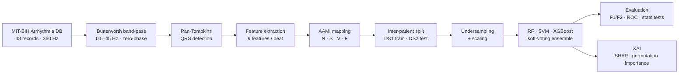
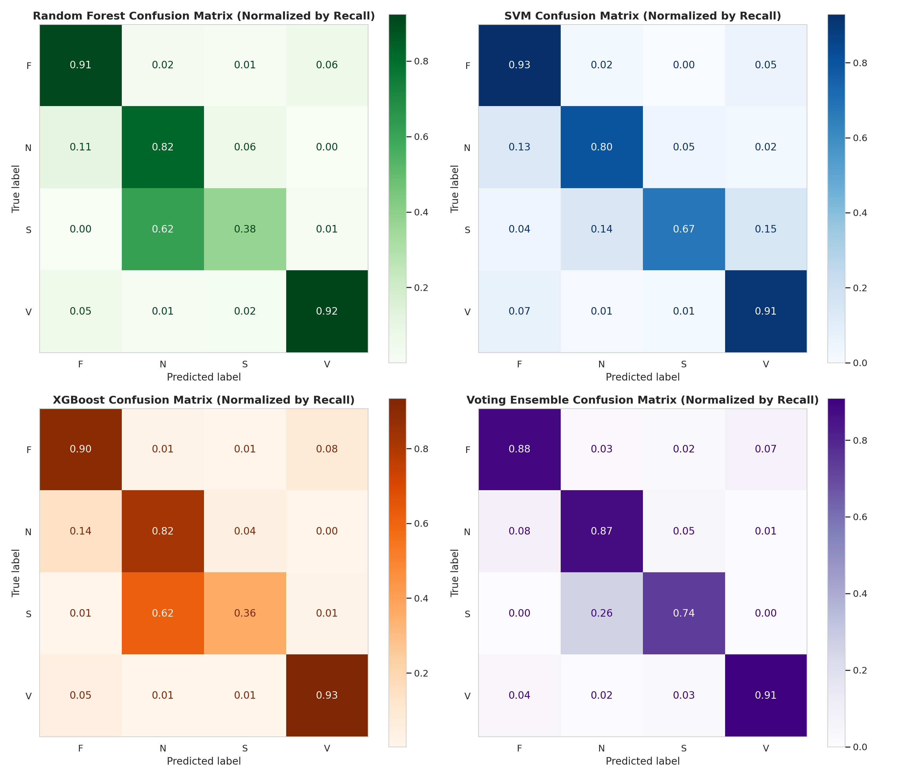
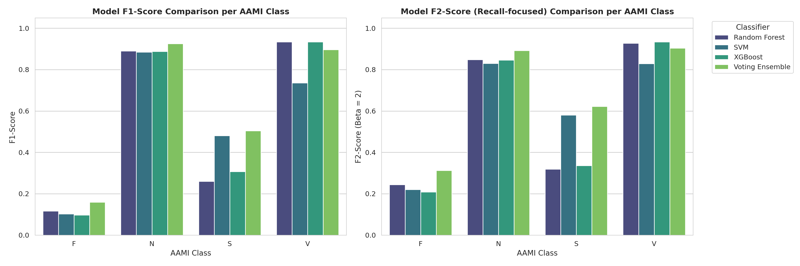
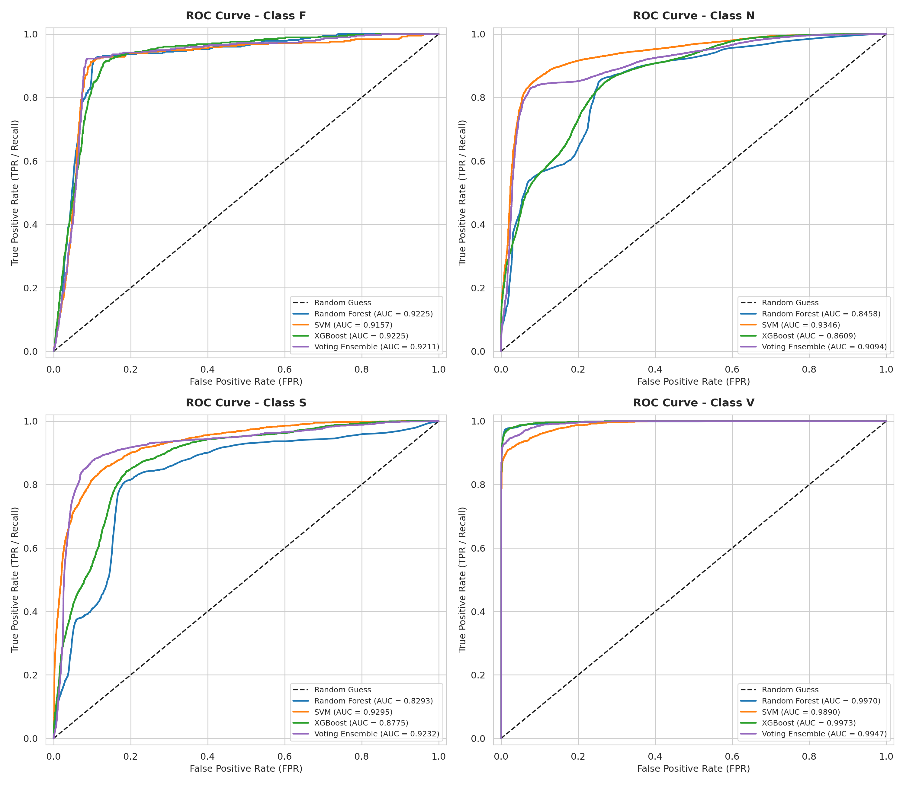
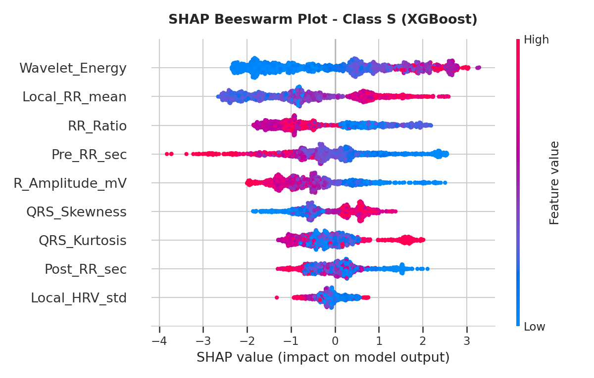
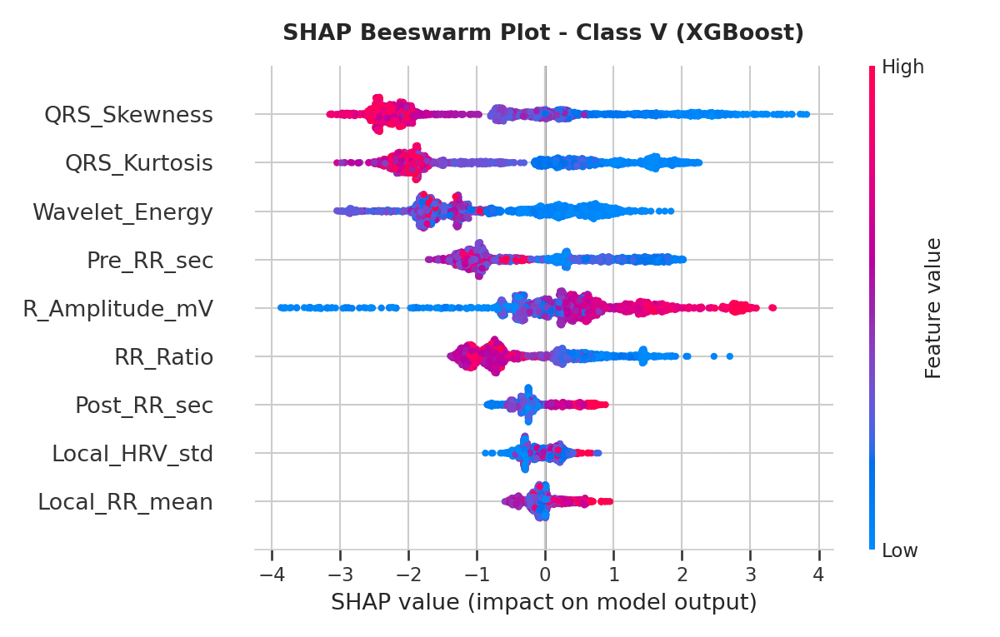
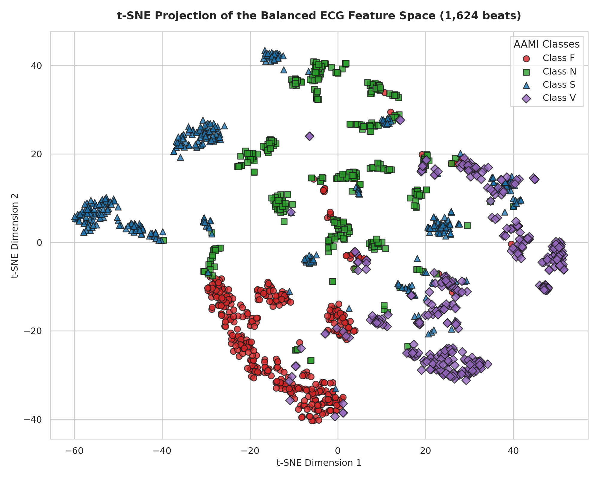
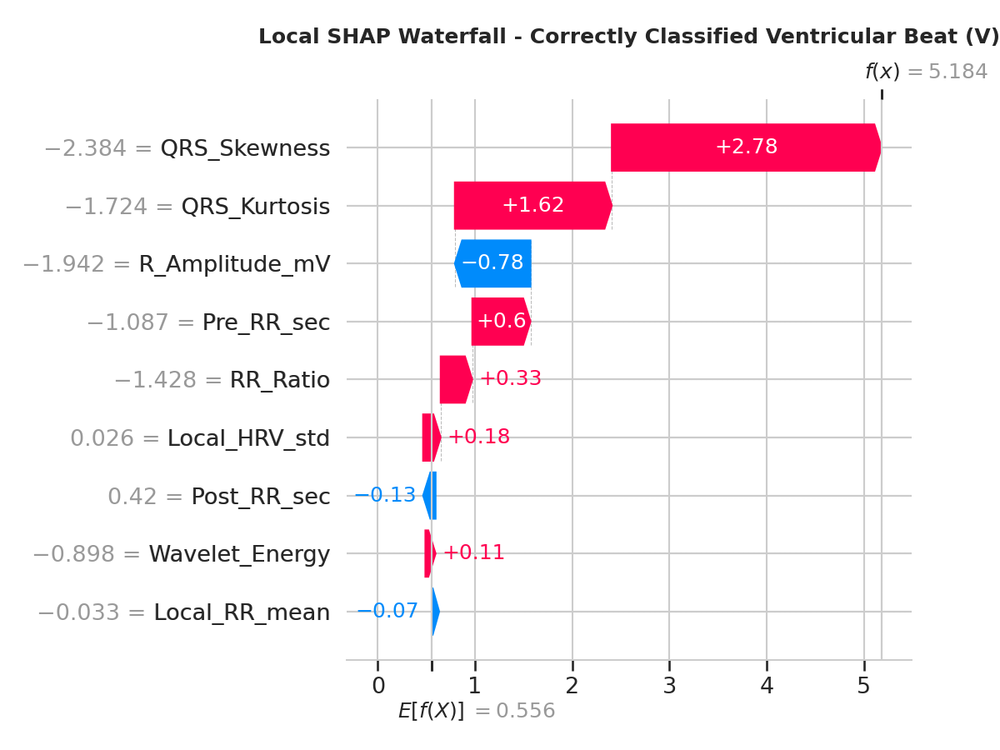

<div align="center">

# HEART
### Heartbeat Extraction and Arrhythmia Recognition Tool

**End-to-end ECG arrhythmia classification on MIT-BIH: signal processing, Pan-Tompkins QRS detection, handcrafted features, inter-patient machine learning and explainable AI (SHAP).**

[](https://www.python.org/)
[](https://scikit-learn.org/)
[](https://xgboost.ai/)
[](https://shap.readthedocs.io/)
[-C41E3A)](https://physionet.org/content/mitdb/1.0.0/)
[](LICENSE)

*Data Mining & Machine Learning project · M.Sc. in Artificial Intelligence and Data Engineering · University of Pisa · A.Y. 2025–2026*

</div>

---

## Overview

Cardiac arrhythmias are among the leading causes of cardiovascular mortality, and spotting rare abnormal beats in hours of Holter ECG is tedious and error-prone. **HEART** is a complete, interpretable pipeline that turns raw ECG recordings into beat-level arrhythmia predictions following the **AAMI EC57** standard classes:

| Class | Meaning | Beats |
|:---:|---|---:|
| **N** | Normal and bundle branch block beats | 87,791 |
| **S** | Supraventricular ectopic beats | 2,643 |
| **V** | Ventricular ectopic beats | 5,615 |
| **F** | Fusion of ventricular and normal beats | 783 |

Key design choices:

- **Inter-patient evaluation** (De Chazal DS1/DS2 split): train and test beats come from *different patients*, avoiding the data leakage that inflates many published results.
- **Recall-oriented metrics** (macro F2-score): in a clinical screening setting, missing an arrhythmia costs more than a false alarm.
- **Explainability**: SHAP (global and local) and permutation importance show *why* each beat is classified, and the explanations match known cardiology criteria.

## Pipeline



### 1. Signal processing & QRS detection — [`01_preprocessing_feature_extraction.ipynb`](notebooks/01_preprocessing_feature_extraction.ipynb)

- **Denoising:** 3rd-order zero-phase Butterworth band-pass (0.5–45 Hz) to remove baseline wander, powerline interference and muscle noise.
- **QRS detection:** custom Pan-Tompkins implementation (derivative, squaring, moving-window integration) with local peak re-alignment to compensate filter group delay.
- **Validation:** on benchmark record 111, the detector matches **2,115 of 2,133** cardiologist-annotated beats (**99.16% sensitivity**, 50 ms tolerance).

### 2. Features (9 per heartbeat)

| Group | Features |
|---|---|
| **Rhythm / local HRV** | Pre-RR, Post-RR, RR ratio, local mean RR, local HRV std (10-beat window) |
| **Morphology** | R-peak amplitude (mV), QRS skewness, QRS kurtosis (200 ms window) |
| **Spectral** | High-frequency energy from a 3-level DWT with Daubechies-4 wavelet |

The resulting dataset ([`data/ECG_Features_Complete_SOTA.csv`](data/ECG_Features_Complete_SOTA.csv)) has **96,832 beats**, with 47,963 in DS1 (22 training records) and 48,869 in DS2 (23 test records).

### 3. Machine learning & XAI — [`02_ml_training_xai.ipynb`](notebooks/02_ml_training_xai.ipynb)

- **Class imbalance:** aggressive random undersampling to 406 beats per class. It was compared with moderate undersampling + class weights and gave far better recall on S and F beats (F2-macro 0.68 vs ≤ 0.58).
- **Models:** Random Forest (1000 trees, depth 20), RBF-SVM (C = 10), XGBoost (500 trees, depth 3, lr 0.1), tuned by grid search with 10-fold stratified CV, plus a **weighted soft-voting ensemble**.
- **Statistics:** Friedman and pairwise Wilcoxon signed-rank tests on CV scores.
- **Explainability:** SHAP beeswarm/importance per class (RF vs XGBoost), SHAP waterfall plots for single beats including misclassifications, SVM permutation importance and decision-boundary slices.

## Results

Evaluation on the **unseen DS2 patients** (48,869 beats, original class imbalance):

| Model | Accuracy | Macro F1 | **Macro F2** | Macro ROC-AUC |
|---|:---:|:---:|:---:|:---:|
| Random Forest | 0.81 | 0.55 | 0.585 | 0.899 |
| SVM (RBF) | 0.80 | 0.55 | 0.615 | **0.942** |
| XGBoost | 0.81 | 0.56 | 0.581 | 0.915 |
| **Voting Ensemble** | **0.87** | **0.62** | **0.683** | 0.937 |

Per-class **recall** of the ensemble: **N 0.87 · S 0.74 · V 0.91 · F 0.88**. Most rare arrhythmic beats are caught, at the cost of precision on the minority classes, which suits a screening tool.

<p align="center">
  
</p>

<p align="center">
  
  
</p>

### Explainability

SHAP shows that **supraventricular (S)** beats rely heavily on **rhythm context** (local mean RR, RR ratio, pre-RR) together with wavelet energy, consistent with their prematurity and normal-looking QRS. **Ventricular (V)** beats are instead driven by **QRS morphology** (skewness, kurtosis, wavelet energy), reflecting their wide, abnormal complexes. Boosting (XGBoost) concentrates attribution on fewer features than bagging (Random Forest).

<p align="center">
  
  
</p>

<p align="center">
  
  
</p>

More figures in [`figures/`](figures/). The full analysis is in the [report](docs/report.pdf) and the [slides](docs/slides.pdf).

## Getting Started

```bash
git clone https://github.com/michelinot99/HEART.git
cd HEART

python3.10 -m venv .venv
source .venv/bin/activate

# macOS only: OpenMP runtime required by XGBoost
brew install libomp

pip install -r requirements.txt

jupyter lab notebooks/
```

- **`02_ml_training_xai.ipynb`** runs directly on the pre-computed feature file in `data/`.
- **`01_preprocessing_feature_extraction.ipynb`** rebuilds that file from raw signals. If a local copy of the database (`mit-bih-arrhythmia-database-1.0.0/` in the repository root) is not found, the records are downloaded automatically from PhysioNet with `wfdb`.
- Figures are saved to `figures/`. The grid-search heatmap (`grid_search_heatmap.png`) is produced only when the hyperparameter search cell is run.

## Project Structure

```
HEART/
├── notebooks/
│   ├── 01_preprocessing_feature_extraction.ipynb   # Filtering, Pan-Tompkins, features, AAMI split
│   └── 02_ml_training_xai.ipynb                    # Training, evaluation, statistics, SHAP
├── data/
│   └── ECG_Features_Complete_SOTA.csv              # 96,832 beats × 9 features (+ labels, split)
├── figures/                                        # Evaluation plots
│   └── shap/                                       # SHAP global and local explanations
├── docs/
│   ├── report.pdf
│   └── slides.pdf
└── requirements.txt
```

## Team

| Name | Contact |
|---|---|
| **Michele Ivo Galella** | [@michelinot99](https://github.com/michelinot99) |
| **Benedetta Tintori** | [@btintori](https://github.com/btintori) |

## Acknowledgements

Developed for the **Data Mining & Machine Learning** course (M.Sc. in Artificial Intelligence and Data Engineering, University of Pisa).

The feature dataset is derived from the **MIT-BIH Arrhythmia Database** (PhysioNet, ODC Attribution License):

- Moody GB, Mark RG. *The impact of the MIT-BIH Arrhythmia Database.* IEEE Eng in Med and Biol 20(3):45-50 (2001).
- Goldberger AL, et al. *PhysioBank, PhysioToolkit, and PhysioNet.* Circulation 101(23):e215–e220 (2000).

Methodological references: Pan & Tompkins (1985) for QRS detection; de Chazal et al. (2004) for the inter-patient protocol; ANSI/AAMI EC57 for beat classes.

## Citation

If you use this work, please cite it via [`CITATION.cff`](CITATION.cff) (GitHub: *"Cite this repository"*).

## License

Code released under the [MIT License](LICENSE). The data in `data/` is derived from MIT-BIH and remains subject to its original license.
